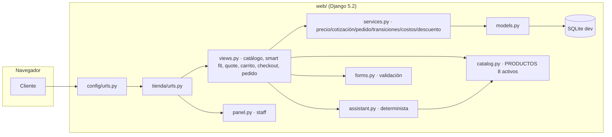
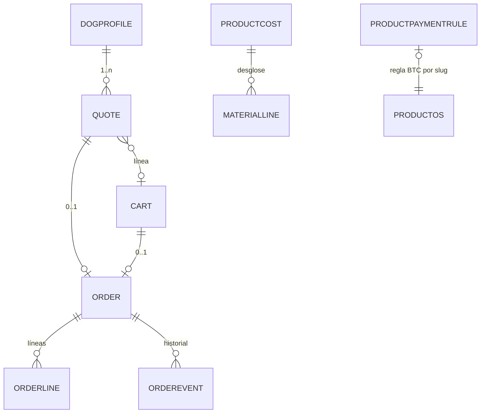
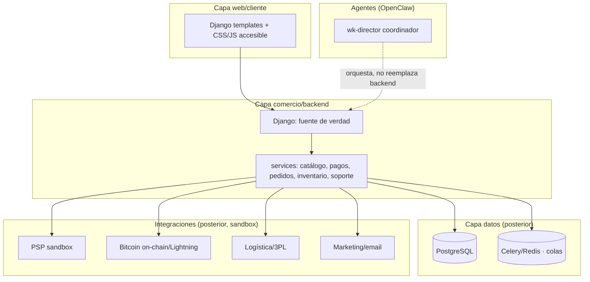

# ARCHITECTURE — Wiener Kingdom (Django conservado, transición por etapas)

> Regla: NO reescribir Django por Next.js. Mejorar en etapas, preservando URLs, formularios CSRF, clases, estados, migraciones y suite.

## 1. Arquitectura actual (verificada)


## 2. Modelo de datos (resumen)


## 3. Arquitectura objetivo (fases, módulos opcionales posteriores)


## 4. Principios de transición
1. **Primero templates + CSS/JS accesible**, sin tocar lógica de pagos.
2. **Precio siempre en servidor** (services.py); el navegador solo elige producto/cantidad.
3. **Estados independientes** de pago/producción/envío se conservan.
4. **Módulos opcionales** (Postgres, Celery/Redis, SPA, servicios externos) solo si el problema lo justifica y hay ADR.
5. **Agentes OpenClaw** coordinan desarrollo en workspaces separados; NO reemplazan el backend de negocio.

## 5. Sitemap real (rutas verificadas en tienda/urls.py)
```
/                          inicio
/productos/                catálogo
/producto/<slug>/          ficha
/smart-fit/                medidas
/guide/                    asistente guiado
/smart-fit/<uuid>/         resultado medidas
/smart-fit/<uuid>/editar/  editar perfil
/smart-fit/<uuid>/cotizar/ crear cotización
/quote/<uuid>/             cotización
/quote/<uuid>/cantidad/    ajustar cantidad
/quote/<uuid>/checkout/    checkout directo
/quote/<uuid>/to-cart/     a carrito
/cart/ · /cart/add/ · /cart/checkout/
/cart/line/<uuid>/ · /cart/line/<uuid>/remove/
/order/<uuid>/             seguimiento cliente
/panel/login/ · /panel/logout/
/panel/ · /panel/orders/<uuid>/ · /panel/orders/<uuid>/sheet/
/panel/payments/ · /panel/measurements/ · /panel/costs/ · /panel/costs/<slug>/
```

## 6. Ramas recomendadas (para cuando exista fork autorizado)
- `proposal/wk-atlas-and-architecture` — docs + preview aislado (PR docs-only primero)
- `feature/wk-visual-refresh` — CSS/templates sin tocar pagos
- `feature/wk-staging-hardening` — seguridad
- `feature/wk-payments-sandbox` — PSP sandbox (tras decisión legal)
- `experiment/wk-innovation-lab` — funciones avanzadas aisladas