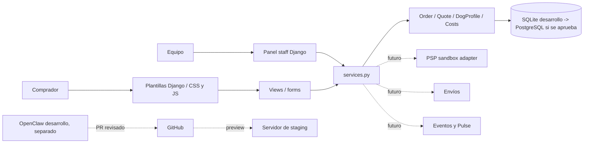

# Arquitectura incremental — respetar Django

## Razones para NO reescribir el núcleo

Conservar validaciones, reglas de cálculo, estados de producción/pago y suite extensa del equipo. La interfaz puede evolucionar sin sustituir contratos ni migraciones existentes.

## Evolución recomendada

1. Diseño visual y accesibilidad en plantillas actuales.
2. Aislamiento config dev/staging/prod y logs.
3. Integraciones a través de adapters independientes.
4. Postgres + colas tras necesidad, no por moda.
5. API y SPA/PWA opcionales cuando los nuevos clientes y métricas lo justifiquen.

## Compatibilidad Vercel

Vercel puede alojar demos estáticas y frontends elegibles. **No asumir que desplegar el HTML demo en Vercel convierte Django en aplicación productiva**. El backend Django, BD persistente, jobs, medios y sesiones requieren arquitectura y hosting adecuados, que podría ser distinto o complementario. El plan Hobby no debe usarse para ventas comerciales si sus condiciones lo excluyen.
