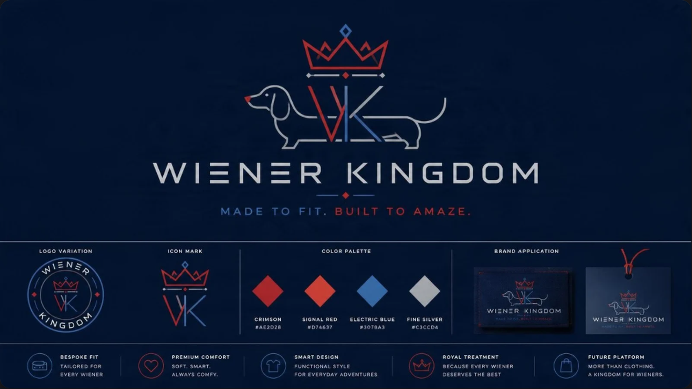
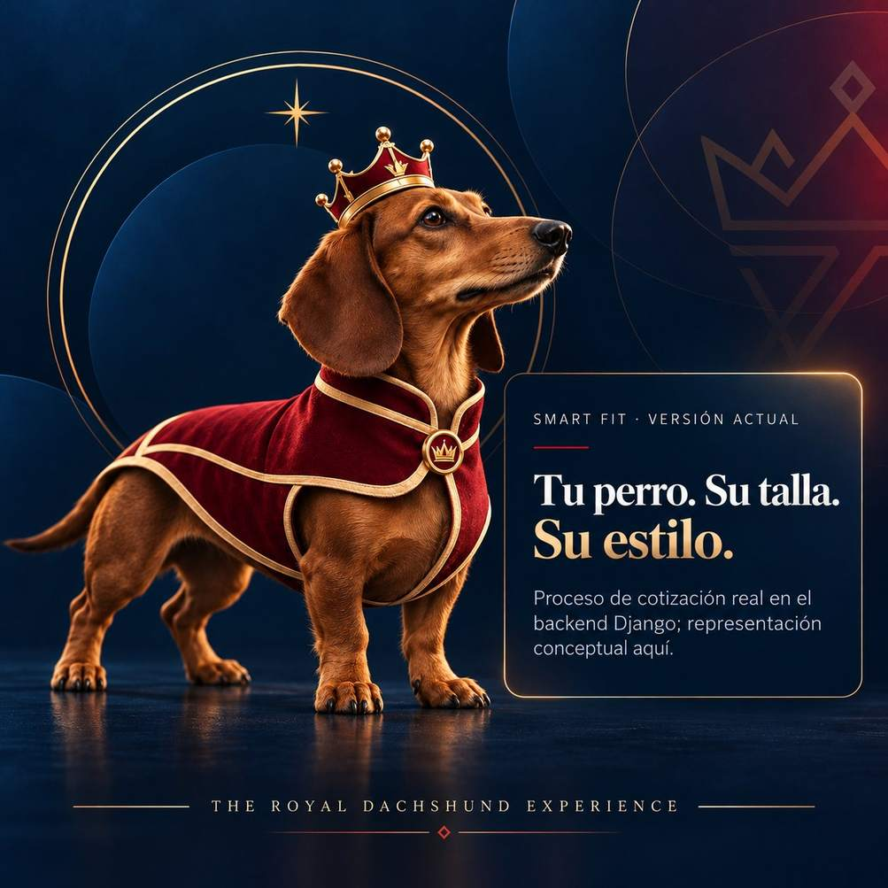
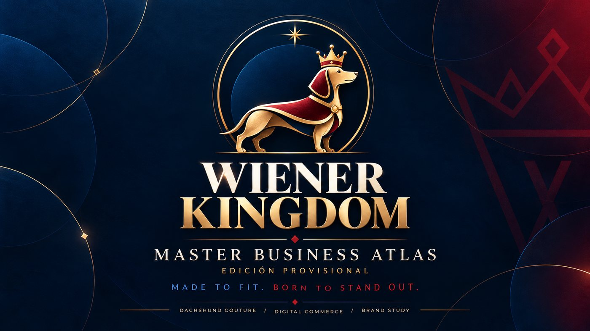
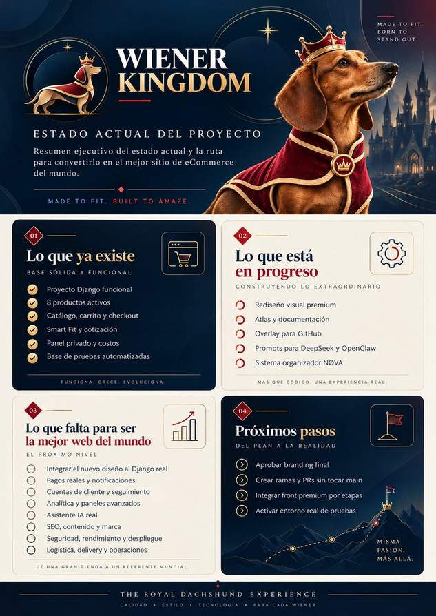

# Wiener Kingdom — sistema de marca provisional

**Identidad principal seleccionada:** la lámina de Canva anterior, con dachshund lineal, corona y monograma VK/WK. No reemplazar por ilustraciones conceptuales de perro. Las piezas editoriales adicionales son ilustraciones, no logos oficiales.

## Posicionamiento

**Luxury with a little mischief.** Prendas de dachshund que convierten el ajuste, la personalidad y el cuidado en una experiencia premium. Un negocio de nicho que puede crecer hacia herramientas de comercio inteligente mediante módulos independientes.

## Naming

Forma deseada: **Wiener Kingdom** (el repositorio actual usa también **Weiner Kingdom**, pendiente de acuerdo con compañeros). No cambiar el nombre del repo, dominio o marca registrada de forma unilateral. No se ha verificado disponibilidad legal.

## Logo seleccionado a partir de la lámina de Canva

Isotipo geométrico **WK**: corona de tres puntas, silueta alargada de dachshund integrada en forma abstracta. Evitar mascotas genéricas, dibujos ajenos o referencias a franquicias conocidas.

## Paleta

| Token | HEX | Aplicación |
|---|---|---|
| royal-night | `#101E36` | Encabezados y fondos oscuros |
| oxblood | `#842F34` | Marca profunda |
| vermilion | `#AF3635` | CTA primario |
| electric-steel | `#366A91` | Tecnología, enlaces |
| silver | `#C5CBD5` | Contornos |
| ivory | `#FAF8F6` | Fondos boutique |
| ink | `#1A2538` | Texto |

Paleta inspirada en la imagen de referencia; se adapta para legibilidad y estética premium. La figura de superhéroe usada para indicar los colores **no se reutiliza**.

## Tipografía

Space Grotesk / Inter o equivalentes de licencia abierta. Titulares elegantes y compactos; cuerpo legible. Tamaños móviles AA.

## Sistema UI

Hero editorial con dachshund original, colección en tarjetas fotográficas reales cuando existan permisos, detalles de talla transparentes, carrito claro, checkout sin efectos distractores, y panel de vendedor con métricas trazables.

## Copy

- Titular: **Pequeños de tamaño. Realeza de corazón.**
- English: **Made to fit. Born to stand out.**
- Lo que vendemos hoy: prendas y accesorios para dachshunds.
- Lo que exploramos mañana: comercio mejor conectado.

## Prohibiciones

No usar logos, ilustraciones, personajes ni assets protegidos de terceros sin permiso. No usar datos, credenciales ni trabajo privado de otras iniciativas en documentos compartidos.

## Arte editorial reutilizable (no isotipos)

**Política visual:** ninguna caricatura canina. Mostrar fotografías reales verificadas para la venta cuando exista autorización de uso; si faltan, tarjetas tipográficas y textiles marcados como demostrativos. No declarar que renders IA son productos reales.
